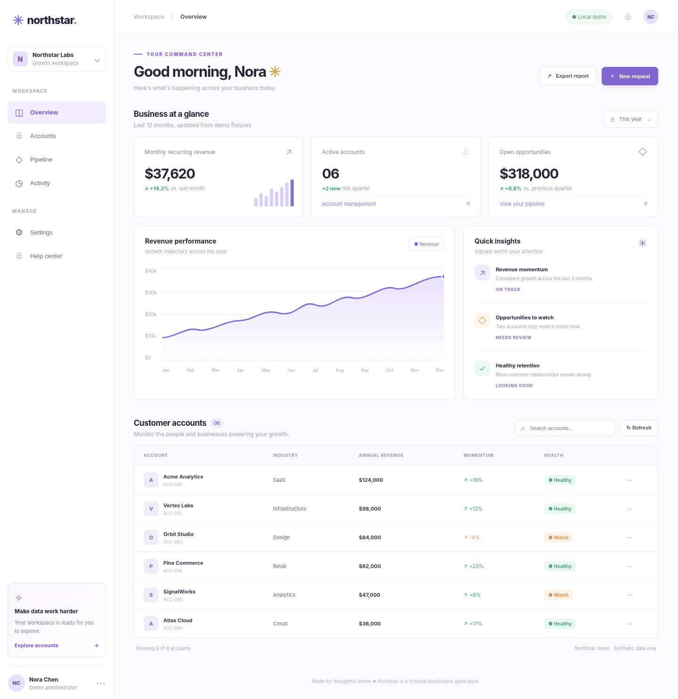

<div align="center">

# antiRea
### Bảo vệ phần giá trị thật của ứng dụng, không dựa vào ảo tưởng rằng giao diện có thể bị giấu khỏi trình duyệt.

**Bộ công cụ phòng vệ có kiểm chứng · TypeScript SDK · AI Agent Skill**

[English](README.md) · [Mô hình rủi ro](docs/THREAT_MODEL_REA.md) · [Giới hạn](docs/LIMITATIONS.md) · [Nguồn nghiên cứu](docs/REFERENCES.md)

 

</div>

## Mới trong v2.1: Demo SaaS A/B + benchmark tái lập



Đã dựng **Northstar**, ứng dụng SaaS giả lập với dashboard, tìm kiếm khách hàng, tạo yêu cầu, xuất CSV, biểu đồ và responsive UI. Có hai chế độ **không bảo vệ** (`http://127.0.0.1:4173`) và **có bảo vệ** (`http://127.0.0.1:4174`), dùng cùng dữ liệu giả lập, giao diện và workflow. Chế độ protected chạy các module TypeScript antiRea thật đã biên dịch, ghi nhận canary và kiểm soát xuất CSV trên máy chủ. Bộ Playwright đo kiểm chức năng, khả năng quan sát, phản hồi HTTP, báo cáo lỗi và chụp ảnh hai trạng thái.

```bash
npm install
npm run build && npm run benchmark:build-sdk
python -m pip install playwright
python -m playwright install chromium firefox webkit
python benchmark/run_all.py --browsers chromium,firefox,webkit --iterations 5
```

Muốn xem giao diện bằng tay, mở hai terminal và chạy `npm run benchmark:baseline` cùng `npm run benchmark:demo`. Đọc [quy trình benchmark](docs/DEMO_BENCHMARK_2_1.md), [hướng dẫn chạy REA thật](benchmark/rea/README.md) và [danh sách app mẫu phù hợp](docs/TARGETS.md). **Trạng thái kiểm chứng:** 30 kiểm thử Node đạt; lần chạy Playwright tại đây bị chính sách Chromium chặn điều hướng localhost; chưa chạy REA trực tiếp. Không biến lỗi môi trường thành điểm số thành công.

## antiRea giải quyết vấn đề gì?

Các công cụ như [morluto/rea](https://github.com/morluto/rea) hỗ trợ quan sát DOM, phân tích JavaScript bundle, quan sát phiên làm việc và chụp giao diện. Những tính năng này có thể phục vụ nghiên cứu và kiểm thử được phép, nhưng cũng khiến việc tái tạo sản phẩm dễ hơn. **antiRea không thể chặn triệt để REA, Chrome DevTools, Playwright hoặc thao tác quay màn hình.** Bất kỳ thông tin nào đã được gửi vào trình duyệt của người dùng phải được coi là có thể bị đọc.

Mục tiêu của dự án là giúp chủ sở hữu và cộng đồng triển khai biện pháp **thực chất, hạn chế tác dụng phụ, có bằng chứng và dễ đánh giá**. Bản 2.0 beta đã sửa nhiều nhược điểm của ZIP gốc: bỏ prompt poisoning gây hại, không dùng vòng lặp `debugger`, không khẳng định watermark ẩn chống nén video và không tự giảm chất lượng dịch vụ của người dùng hợp lệ.

## Bốn tầng và ưu tiên triển khai

| Ưu tiên | Tính năng | Lợi ích có thể kỳ vọng | Giới hạn |
|---|---|---|---|
| **P0 – nền tảng** | Backend nắm thuật toán/secret, phân quyền từng bản ghi, giới hạn quota, hạn chế thông tin trả về | Khó sao chép logic/dữ liệu không được công khai | Không giấu được thứ đã gửi đến tài khoản hợp lệ |
| **Tầng 1** | Cấu hình không public source map; thông báo bản quyền; chữ ký dấu vết SVG/text | Hạn chế vô tình lộ source gốc, hỗ trợ đối chiếu nguồn | Không ngăn soi DOM, chữ ký không phải bằng chứng pháp lý đủ dùng độc lập |
| **Tầng 2** | API canary và tín hiệu automation mức tin cậy thấp | Ghi nhận truy cập bất thường để điều tra | Không chặn hết bot; không tự động ban |
| **Tầng 3** | AES-GCM ràng buộc ngữ cảnh và kiểm tra phát lại | Bảo đảm toàn vẹn và kiểm soát sử dụng lại thông điệp khi khóa được giữ bí mật | Không giấu dữ liệu trước chính trình duyệt có khóa |
| **Tầng 4** | Watermark hiển thị token phiên tạm thời | Hỗ trợ truy vết bản chụp khi token còn hiện rõ | Không chống cắt/crop hoặc xóa watermark |

**Khuyến nghị mặc định:** thực hiện P0 trước, sau đó cấu hình Tầng 1. Với website có API quan trọng, bật honeypot Tầng 2 sau khi rà soát privacy. Tầng 3–4 chỉ sử dụng khi có bài toán thật và đội vận hành hiểu rõ giới hạn.

## Cài đặt và kiểm thử

Cần Node.js 20+. Repo **không có runtime dependency**; để build cần TypeScript (được khai báo là devDependency).

```bash
npm install
npm run check
npm run build
```

`npm run check` gồm biên dịch, **30 kiểm thử tự động** và kiểm tra tĩnh. Có thể kiểm tra thư mục build công khai bằng `python3 scripts/verify-build.py dist`. Chưa có kết quả benchmark chứng minh tỷ lệ chặn REA ngoài thực tế.

Để tích hợp bản chưa public lên npm, chạy `npm pack` rồi cài file `.tgz` trong dự án đích, hoặc dùng trực tiếp phần mã và tài liệu hướng dẫn.

### Mẫu API canary

```ts
import { handleCanaryTrapRequest } from "anti-rea";

const result = await handleCanaryTrapRequest(request, {
  resolveUserId: () => verifiedSession.userId,  // Lấy từ backend đã xác thực
  onAlert: async event => { /* gửi sự kiện đã tối giản đến logger */ },
});
if (result.isTrapped) return Response.json(result.body, { status: result.status });
```

Mặc định code không tin `x-forwarded-for` hoặc `x-user-id`. Header IP chỉ đáng tin khi phía reverse proxy do bạn quản lý đã chặn và thay thế header giả mạo. Không nên khóa tài khoản chỉ vì một lần truy cập canary.

### Mẫu watermark

```ts
import { mountForensicWatermark } from "anti-rea";
const cleanup = mountForensicWatermark({ token: "A7fK3w9Z", enabled: true });
// token → account/session được lưu và phân quyền tại máy chủ
```

Không đưa email, IP hoặc ID thật lên watermark. Thông báo mục đích xử lý dữ liệu, thời gian lưu và quy trình khiếu nại trước khi bật.

### Mẫu provenance notice

```ts
import { injectAgentNotice } from "anti-rea";
const cleanup = injectAgentNotice({
  brandName: "My SaaS",
  canonicalOrigin: "https://app.example.com",
  termsUrl: "https://app.example.com/terms",
});
```

Đây là thông báo điều khoản, **không phải một hàng rào bảo mật** và không có khả năng ép một AI Agent làm theo chỉ dẫn.

## Những nguyên tắc cộng đồng cần giữ

Không cố ý khiến Agent tạo phần mềm lỗi, không phục vụ dữ liệu sai để hại người dùng, không giám sát phím gõ/chụp màn hình trái kỳ vọng, không đưa ra số liệu hiệu năng chưa đo, và không tuyên bố bản quyền chỉ từ một marker dễ bị xóa.

Nếu muốn kiểm chứng antiRea với REA, hãy thực hiện trên **website của bạn hoặc môi trường được phép kiểm thử**, theo [BENCHMARK_PROTOCOL.md](docs/BENCHMARK_PROTOCOL.md), đồng thời công bố cả trường hợp phòng thủ thất bại.

## Tài liệu cho cộng đồng

[Audit bản ZIP gốc](docs/AUDIT_2026-10-31.md) · [Threat model](docs/THREAT_MODEL_REA.md) · [Giới hạn kỹ thuật](docs/LIMITATIONS.md) · [Nguồn học thuật](docs/REFERENCES.md) · [Kiểm soát backend](docs/SERVER_SIDE_CONTROLS.md) · [Pháp lý & quyền riêng tư](docs/LEGAL_PRIVACY.md) · [Hướng dẫn đóng góp](CONTRIBUTING.md) · [Changelog](CHANGELOG.md).

Dự án dùng [MIT License](LICENSE), mở cho cộng đồng đóng góp. [Ủng hộ tác giả qua PayPal](https://www.paypal.com/paypalme/dannyphan190) là tùy chọn.
